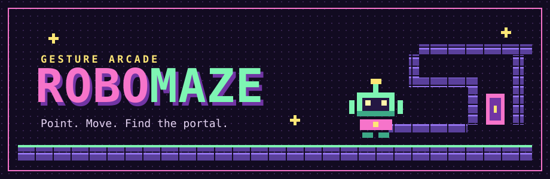

<p align="center"></p>

<p align="center">
  <a href="#run-locally"></a>
  <a href="#controls"></a>
  <a href="#how-it-works"></a>
</p>

## Play

Start the game using the [local setup](#run-locally).

1. Press **Start Game** to open the control setup.
2. Press **Enter Maze** and allow webcam access. Choose **Enter with keyboard or touch** for manual play.
3. Follow the dotted yellow maze drawn over your mirrored camera feed. Guide the robot to the pink portal in **Neon Depot**, **Circuit Garden**, and **Midnight Relay**.

## Controls

| Input | Action |
| :--- | :--- |
| Slide your open hand ↑ ↓ ← → | Move in that direction on the mirrored preview |
| **Gesture movement** menu | Hold to repeat in corridors, or choose one step per shift for tight turns |
| Return your hand to center | Stop gesture movement |
| Arrow keys, WASD, or on-screen arrows | Move one tile per input |
| Restart level | Return to the starting tile and reset the counters |

<details>
<summary><strong>✦ Webcam tips</strong></summary>

Show one hand in good light with the full palm visible. Start with your open hand near the middle of the feed. Five yellow strings connect your fingertips to the robot. Slide your whole hand to steer. Use Recenter hand to set a new resting position. Use **Disable camera** to stop the feed. If permission is blocked, you can still play and retry from the hand tracker panel.

</details>

## How it works

The pretrained [MediaPipe Hand Landmarker](https://ai.google.dev/edge/mediapipe/solutions/vision/hand_landmarker/web_js) estimates 21 landmarks per hand. RoboMaze tracks the center of the five finger bases relative to a neutral position, mirrors horizontal movement, and maps a stable displacement to a grid move. The maze engine checks each move for wall collisions and generates three reproducible layouts using seeded depth-first search.

<details>
<summary><strong>✦ Trace a gesture from camera to maze</strong></summary>

| Stage | Implementation |
| :--- | :--- |
| Webcam frame → landmarks | MediaPipe’s pretrained model runs in the browser using WebAssembly |
| Landmarks → direction | Smoothed displacement of the five finger bases from their neutral position |
| Direction → movement | 48 ms stability threshold, 175 ms repeat interval, and collision checks. Step mode also requires 95 ms of neutral input before the next shift. |

The browser downloads model and runtime files when you enable the camera. Webcam frames are processed locally. The game has no backend or API key.

</details>

## Run locally

Clone the repository, open its root, and run:

```sh
python -m http.server 8000
```

Open [localhost:8000](http://localhost:8000). Camera permission requires HTTPS or localhost. Gesture mode needs internet access to download MediaPipe and the model.


For GitHub Pages hosting, set the publishing source to the root of `main` in the repository’s Pages settings.

## Robot Arms

Open **Robot Arms · Dance Stage** from the arcade title screen. Pick **Arm wave**, **Side shuffle**, or **Power bounce** and start or pause the choreography. Enable the camera to link your five fingertips to the robot with yellow strings. Moving your hand changes the robot’s pose, and curling different fingers bends its arms or legs or shifts its chest light.

Choose **Direct hand control** for a pose driven by hand position and finger curl. Both modes use motion-adaptive landmark smoothing to reduce jitter while responding to larger movements quickly.

## Robo Punch

Open **Robo Punch** and enable the camera. Touch your thumb to your index or middle fingertip, then snap that finger outward. The robot launches in the mirrored flick direction and rebounds off the fixed arena walls. Faster flicks impart more speed. **Demo flick** works without a camera.

Choose Rose Prism, Obsidian, Crimson Reactor, or Tidal Glass to change the arena artwork and impact patterns. Cube artwork stays visible over the mirrored feed in camera mode.

## Robo Punch Pro

Open **Robo Punch Pro** for a perspective-projected cube with six collision faces. Drag the stage or use its arrow-key controls to orbit. Camera flicks use the tracked finger's relative horizontal, vertical, and depth movement, and the demo cycles through six directions without a camera. Pick from four original procedural cube materials.

Both Punch modes share a **Choose your robot** picker with twelve illustrated characters. The selected outfit carries between the two modes in the same browser.
